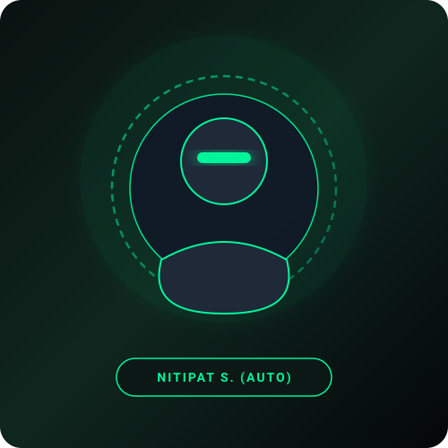

# Creative Media Portfolio — Nitipat Supakdee (Auto)

Modern & Minimalist personal portfolio website for **Nitipat Supakdee (Auto)**, a Creative Media student at the Faculty of Informatics, Mahasarakham University.



## 🎨 Color Palette
- **Primary Neon Green**: `#00F59B` & `#10B981`
- **Dark Space Black**: `#080B10` & `#0F141C`
- **Clean White / Light Gray**: `#FFFFFF` & `#94A3B8`

## 🛠️ Tech Stack
- **HTML5** & Semantic Elements
- **CSS3** (Custom Properties, Glassmorphism, Animations)
- **JavaScript (ES6+)** (Interactive filtering, dynamic modal, contact form validation)
- **Bootstrap 5.3** (Responsive Grid, Navbar, Carousel, Modals)
- **Google Fonts** (`Plus Jakarta Sans`)
- **Font Awesome 6** (Vector Icons)

## 📁 Project Structure
```
├── index.html          # Home / Landing Page & Personal Profile
├── education.html      # Academic Journey & Timeline
├── portfolio.html      # Filterable Creative Works (All, Art, 3D Model, Graphics)
├── activity.html       # Events & Workshops with Bootstrap Carousel
├── contact.html        # Contact Info & Message Form
├── assets/
│   ├── css/
│   │   └── style.css   # Custom Stylesheet
│   ├── js/
│   │   └── main.js     # Interactive UI Scripts
│   └── images/         # SVG Assets & Placeholders
├── Porfolio3048/       # Academic submission package
└── README.md
```

## 👤 Personal Information
- **Name**: Nitipat Supakdee (นิธิพัฒน์ สุภักดี)
- **Nickname**: Auto (ออโต้)
- **Date of Birth**: 9 October 2005
- **Phone**: +66 956167236
- **Email**: autokung0536@gmail.com
- **Location**: Mahasarakham, Thailand
- **Institution**: Mahasarakham University (MSU)

---
© 2026 Nitipat Supakdee. All rights reserved.
